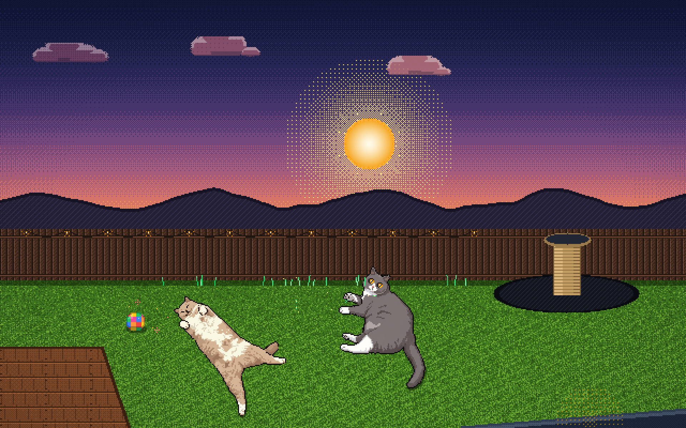
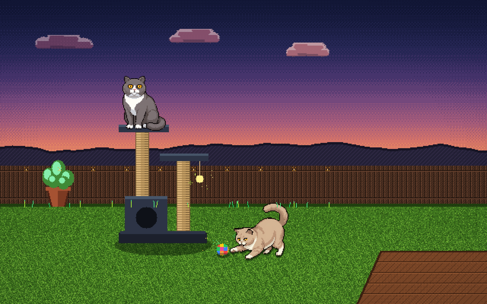
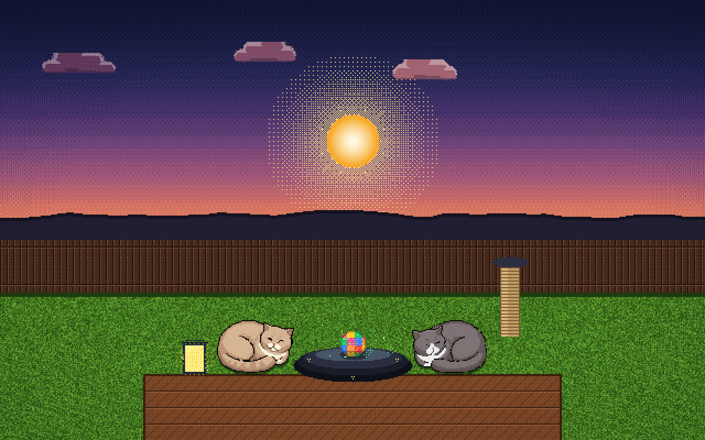
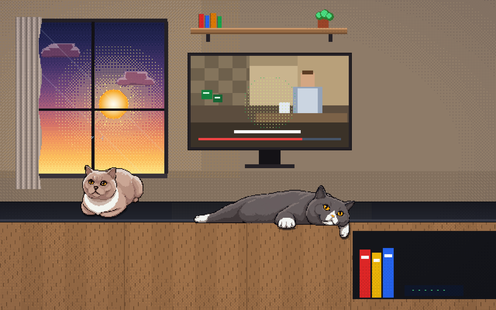
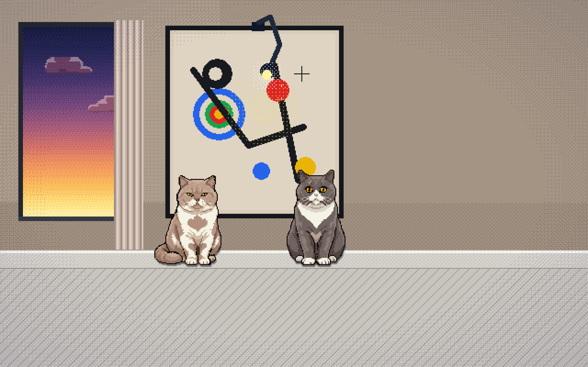
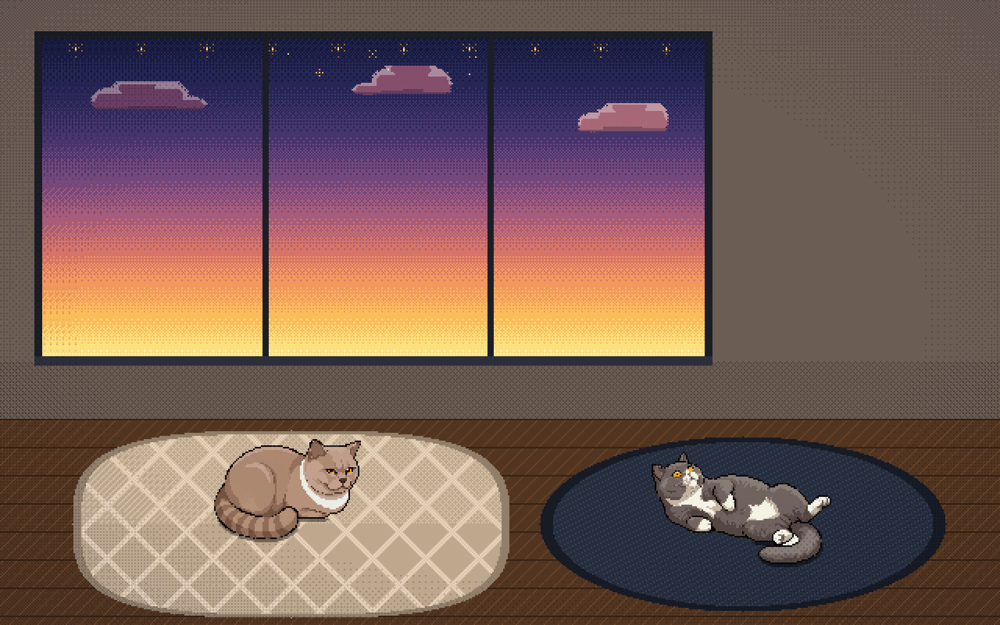

# PixelZen Worlds

[](https://github.com/davidlpizano/pixelzen-worlds/releases/latest)
[-e6b45a)](#mundos-incluidos-monitor-1--monitor-2--bloqueo)
[](#panel-hud-flotante-9-tarjetas)
[](LICENSE)

Aplicación de escritorio y motor modular de fondos pixel art animados en **640×400** (escalado nítido **Nearest-Neighbor**) con interpolación astronómica solar entre día, hora dorada y noche estrellada (**tiempo real**, **ciclo suave 24 h en 90 minutos**, **demo 90 s** u **hora fija**), clima dinámico en tiempo real, eventos épicos, reactividad de audio, continuidad narrativa en **3 pantallas (Monitor Principal, Monitor 2 y Pantalla de Bloqueo)** y **9 tarjetas HUD flotantes** adaptadas a cada universo para **Windows 10/11**, **Linux (GNOME Shell 46–50+)** y **sitio web interactivo** en [`docs/`](docs/).

> **Basado en [mosqui1988/pixelzen](https://github.com/mosqui1988/pixelzen)** (port GNOME Shell / KDE Plasma bajo licencia `GPL-3.0-or-later`).

---

## Descarga e instalación rápida

### Windows 10 / 11 (sin archivos `.exe` · compatible con Control inteligente de aplicaciones)

No necesitas clonar el repositorio ni instalar Python para ejecutar el motor nativo (`PixelZenMotor.ps1`) ni el Estudio Desktop (`PixelZenMenu.ps1`). Abre **PowerShell** y ejecuta un único comando:

```powershell
irm https://raw.githubusercontent.com/davidlpizano/pixelzen-worlds/main/scripts/instalar.ps1 | iex
```

También puedes usar el instalador web [`docs/Instalar-PixelZenWorlds.bat`](docs/Instalar-PixelZenWorlds.bat) o descargar **`PixelZenWorlds-Windows.zip`** / **`PixelZenWorlds-Setup.exe`** desde **[GitHub Releases](https://github.com/davidlpizano/pixelzen-worlds/releases/latest)**.

El instalador instala la aplicación limpia en `%LOCALAPPDATA%\PixelZenWorlds\app`, crea el acceso directo **PixelZen Worlds** en Escritorio y Menú Inicio, conserva tu configuración al actualizar y registra desinstalación estándar en *Configuración → Aplicaciones*.

### Linux (Ubuntu 24.04+ / GNOME Shell 46–50+)

```bash
cd linux
./instalar.sh --90m
```

O descarga **`PixelZenWorlds-Linux-Setup.run`** desde Releases, dale permisos (`chmod +x`) y ejecútalo para instalar la extensión GNOME Shell, la tipografía *Departure Mono* y la app visual GTK4.

---

## Características principales

* **17 Universos × 3 Pantallas (51 escenas / 153 vistas en Día, Dorado y Noche)**:
  * **Monitor 1 (`principal`)**: escena principal animada detrás de los iconos del escritorio mediante el motor nativo C# GDI+ (`WorkerW` / `NEAREST`) o navegador/Lively/GNOME.
  * **Monitor 2 (`secundario`)**: continuación geográfica o narrativa del mismo mundo (o mundo independiente elegido en el estudio) sin duplicar sol ni luna entre pantallas.
  * **Pantalla de Bloqueo (`bloqueo`)**: tercer escenario ceremonial aplicable automáticamente al bloqueo de Windows desde el estudio.
* **Motor vivo con Clima, Eventos Épicos, Audio Synth y Parallax**:
  * **Clima atmosférico** (`Normal`, `Lluvia`, `Tormenta`, `Nieve`, `Niebla`, `Auto`) con reflejos y relámpagos en pixel art nativo.
  * **Eventos épicos**: cometa fugaz, invocación arcana y anomalía dimensional en horas en punto o bajo demanda (`Ctrl+Alt+E` o botón en estudio/web).
  * **Audio reactivo & Synth Lo-Fi**: sintetizador Web Audio API integrado + compatibilidad `livelyAudioListener` pulsando partículas y auras.
* **Productividad & Rendimiento en Windows**:
  * **Smart Pause Gaming / Batería**: pausa automática (0% CPU/GPU) al detectar juegos o vídeo a pantalla completa o batería baja.
  * **Playlist & Atajos globales**: rotación automática de mundos configurable (`5–60 min`) y atajos `Ctrl+Alt+W` (mundo), `H` (HUD), `F` (clima), `P` (pausa), `E` (evento).
* **Ciclo solar astronómico continuo**: calcula elevación y azimut reales del sol (hora real, ciclo de 24 h en 90 min, demo rápida 90 s u hora fija interactiva).
* **Desktop Studio + Bandeja del sistema** ([`windows/PixelZenMenu.ps1`](windows/PixelZenMenu.ps1)): selector visual por series/mundos/pantallas, vistas previas Día/Dorado/Noche, menú multimedia/clima en bandeja y buscador de actualizaciones.
* **Sitio web completo y visor offline** ([`docs/`](docs/) + [`temas-bundle.js`](docs/temas-bundle.js)): demo en vivo para 1–3 pantallas, comparador interactivo en pantalla dividida, exportador **4K / 1080p PNG**, galería filtrable de 51 escenas y centro de instalación.

---

## Panel HUD Flotante (9 tarjetas)

En Windows ([`windows/PixelZenHud.ps1`](windows/PixelZenHud.ps1)) las tarjetas flotan como ventana WPF transparente al ratón (`WS_EX_TRANSPARENT`); en web y Lively ([`src/pixelzen-canvas.js`](src/pixelzen-canvas.js)) se sincronizan mediante HTML5 + [`windows/datos_win.py`](windows/datos_win.py). Cuando hay **más de 5 tarjetas activas**, el HUD cambia automáticamente a **disposición de 2 columnas** para no saturar la altura de pantalla:

| # | Tarjeta | Qué muestra |
|---|---|---|
| 1 | **✦ Tiempo y Mundo** | Reloj digital con segundero, fecha en español, modo horario y título del mundo |
| 2 | **☀ Órbita & Clima** | Elevación solar astronómica, azimut, barra de luz diaria y fase (`DÍA / DORADA / NOCHE`) |
| 3 | **❖ Sistema** | Carga CPU, memoria RAM usada/total con barras, porcentaje de disco, batería/AC y uptime |
| 4 | **▣ GPU & Motor** | Gráfica detectada (`Win32_VideoController` / registro / WebGL), carga estimada, resolución y FPS |
| 5 | **◈ Red** | Adaptador activo (Wi-Fi/Ethernet), IP IPv4 y tasas vivas de descarga/subida (`↓ / ↑`) |
| 6 | **♪ BSO del Mundo** | Banda sonora acorde al universo elegido + BPM y detección de reproductores activos |
| 7 | **⚔ Entorno Dev** | Nombre del equipo, repositorio y rama Git con estado de cambios, PowerShell/Python y monitores |
| 8 | **⧖ Foco Zen** | Temporizador Pomodoro en ciclos de 25 minutos con progreso y tiempo acumulado de sesión |
| 9 | **✧ Grimorio** | Citas icónicas rotativas propias de cada anime o serie |

---

## Mundos incluidos (Monitor 1 + Monitor 2 + Bloqueo)

| Mundo (`id`) | M1 · Monitor Principal | M2 · Monitor 2 (Continuación) | M3 · Pantalla de Bloqueo |
|---|---|---|---|
| **Región de Fittoa** (`fittoa`) · *Mushoku Tensei* | <br/>**Aldea de Buena**: Mansión Greyrat, lago, arco rúnico y Gran Roble. | <br/>**Base de Perugius**: Chaos Breaker flotando sobre Ars. | <br/>**Santuario del Teletransporte**: monolito de maná y bosque de Buena. |
| **Continente Demoníaco** (`continente-demoniaco`) · *Mushoku Tensei* | <br/>**Rikarisu**: agujas de basalto, cristales de maná y monolitos carmesí. | <br/>**Fortaleza Basalto**: mesetas volcánicas y Rudeus conjurando *Aqua Heartia*. | <br/>**Puerta de Obsidiana**: puente de roca roja y río de magma. |
| **Isla Ballena y H×H** (`hunter-x-hunter`) · *Hunter × Hunter* | <br/>**Isla Ballena**: Árbol del Mundo, muelle de Gon, cabaña y Aura Nen. | <br/>**Greed Island**: torre de Eta y Elena, Gon y Killua sobre la pradera. | <br/>**Torre Celestial**: Piso 251, metrópolis iluminada y dirigible. |
| **Reino del Trébol** (`black-clover`) · *Black Clover* | <br/>**Aldea de Hage**: Cráneo del Demonio, Iglesia, Torre de Grimorios y espada. | <br/>**Reino de Picas**: fortaleza helada bajo el sello Qliphoth y Asta con *Danma*. | <br/>**Altar del Grimorio Real**: ruinas góticas y espada antimagia sobre sello rúnico. |
| **Miles Morales** (`spiderman-miles-morales`) · *Marvel* | <br/>**Brooklyn**: Puente, Estatua de la Libertad, Manhattan y Miles con chispas Venom. | <br/>**Midtown y Harlem**: metro elevado Tierra-1610, rascacielos y mural Spider-Verse. | <br/>**Azotea de Harlem**: Miles vigilando el horizonte nocturno de Manhattan. |
| **Monarca de las Sombras** (`solo-leveling`) · *Solo Leveling* | <br/>**Castillo del Monarca**: Sung Jin-Woo, Igris y ejército sombra en el Trono Carmesí. | <br/>**Isla de Jeju**: colmena costera, huevos bioluminiscentes y **Rey Beru**. | <br/>**Portal del Monarca**: portón Rango S con dagas gemelas de Jin-Woo. |
| **Kimetsu no Yaiba** (`demon-slayer`) · *Demon Slayer* | <br/>**Tren Infinito**: Rengoku (Respiración de la Llama) vs Akaza junto al tren descarrilado. | <br/>**Aldea de los Herreros**: sendero del taller entre cedros con Tokito vs Gyokko. | <br/>**Santuario de Glicinias**: torii de Fujikasane y katana Nichirin en altar. |
| **Hawkins y Upside Down** (`stranger-things`) · *Stranger Things* | <br/>**Hawkins**: tormenta carmesí del Azotamentes sobre Casa Creel y chicos en bici. | <br/>**Cabaña Byers**: luces navideñas del abecedario y Demogorgon entre esporas. | <br/>**Reloj de Creel**: maldición de Vecna con grietas escarlata. |
| **Castillo de Hogwarts** (`harry-potter`) · *Harry Potter* | <br/>**Hogwarts y Lago Negro**: torres sobre Escocia, barcas y Quidditch. | <br/>**Hogsmeade y Expreso**: cabañas nevadas, viaducto 5972 y Ciervo Patronus. | <br/>**Andén 9¾ y Reliquias**: King's Cross, Hedwig y Varita de Saúco. |
| **Konoha & Modo Baryon** (`naruto`) · *Naruto* | <br/>**Naruto Modo Baryon**: silueta de Kurama, Naruto con 9 colas Modo Baryon y Baryon Rasengan vs Isshiki y cubos Daikokuten. | <br/>**Konoha y Monte Hokage**: Monumento Hokage, Ichiraku Ramen, Naruto Hokage y Sasuke sobre el Río Naka. | <br/>**Valle del Fin**: estatuas de Hashirama y Madara flanqueando la cascada con choque de Rasengan vs Chidori. |
| **Expansión de Dominio** (`jujutsu-kaisen`) · *Jujutsu Kaisen* | <br/>**Shinjuku**: Sagrario Malevolente de Sukuna con cráneos frente al Vacío Infinito de Gojo y choque Púrpura Vacío. | <br/>**Incidente de Shibuya**: Torre 109, Prisión Confinadora, Yuji Itadori (*Destello Negro*) y Megumi con el Perro Divino. | <br/>**Santuario del Dedo**: calzada sagrada, pagoda entre cedros, puerta Torii bermellón con sellos Ofuda y Dedo de Sukuna. |
| **El Retumbar y la Muralla** (`attack-on-titan`) · *Attack on Titan* | <br/>**El Retumbar**: Titán Fundador, marcha de Titanes Colosales incandescentes, Mikasa y Levi sobre Shiganshina. | <br/>**Muralla María**: Titán Colosal entre relámpagos dorados frente a las casas tradicionales de Shiganshina. | <br/>**Los Caminos**: pilar de La Coordenada en el cielo estrellado y memorial de cuchillas EDM con la bufanda roja. |
| **Gear 5 & Onigashima** (`one-piece`) · *One Piece* | <br/>**Onigashima**: Calavera gigante, Luffy Gear 5 desatando el Bajrang Gun frente a Kaido Dragón Azul. | <br/>**Thousand Sunny**: el barco de los Mugiwara bajo la luna con Zoro y Sanji sobre la cubierta. | <br/>**Road Poneglyph**: monolito carmesí con glifos antiguos, Sombrero de Paja y Fruta Nika. |
| **Ultra Instinto en Namek** (`dragon-ball-z`) · *Dragon Ball Z* | <br/>**Namek en Colapso**: Goku Ultra Instinto Dominado chocando su Kamehameha Divino vs Freezer Dorado. | <br/>**Dragón Shenron**: el dragón sagrado ascendiendo entre relámpagos sobre las 7 Bolas de Dragón. | <br/>**Kame House**: isla del Maestro Roshi, Nube Kinton con el Bastón Mágico y la Bola de 4 Estrellas. |
| **Night City & Sandevistan** (`cyberpunk-edgerunners`) · *Cyberpunk: Edgerunners* | <br/>**Corpo Plaza**: Arasaka, Quadra Turbo-R, David con estela cromática del Sandevistan y Lucy con su monofilo. | <br/>**La Luna**: David y Lucy sentados en la azotea frente a la Luna plateada y el monorraíl NCART. | <br/>**Callejón Afterlife**: mural grafiteado ER en verde ácido e implante espinal Apogee Sandevistan. |
| **Terraza de los Michis** (`terraza-michis`) · *Vida Zen · Mascotas* | <br/>**Siesta en el Césped**: Michi Crema panza arriba, Michi Gris de ojos ámbar, pelotita multicolor y tarima de madera. | <br/>**Torre Rascador y Pelotita**: rascador de dos niveles con pompón, macetas y ambos michis jugando en la terraza. | <br/>**Santuario de la Pelotita**: cojín ceremonial con huellas luminosas, farol cálido y ambos michis durmiendo bajo las estrellas. |
| **Salón de Noah y Maggie** (`salon-noah-maggie`) · *Vida Zen · Mascotas* | <br/>**Noche de Breaking Bad**: salón con ventanal animado, tele reproduciendo *Breaking Bad* y Maggie con su patita blanca colgando junto a Noah en modo panecillo. | <br/>**Rincón del Miró**: posado oficial de Noah y Maggie en el mueble blanco junto al cuadro de Miró y la lamparita de pinza. | <br/>**Cojín de la Siesta**: Noah hecha un bollito sobre el cojín crema tejido de rombos y Maggie estirada panza arriba bajo la guirnalda cálida. |

---

## Estructura para desarrolladores y compilación

```text
pixelzen-worlds/
├── VERSION                     # Versión de compilación y Releases
├── escenas/                    # 17 mundos × 3 variantes (generar.py, tema.json, preview/)
│   ├── _plantilla/             # Plantilla modular base
│   └── <mundo>/                # principal + secundario/ + bloqueo/
├── src/                        # Motor procedural (pz_lib.py, pz_detalles.py, construir.py) + pixelzen-canvas.js
├── windows/                    # Motor nativo C# (PixelZenMotor.ps1), Estudio (PixelZenMenu.ps1), HUD 9 tarjetas y Lively
├── linux/                      # Extensión GNOME Shell 46-50+, app GTK4 e instalar.sh
├── docs/                       # Sitio web completo (index.html, styles.css, app.js, temas-bundle.js, previews/)
├── scripts/                    # Instaladores, empaquetadores (.exe / .run) y sincronizar_todo.ps1
├── tests/                      # Verificación automática (verificar.py)
├── fuentes/                    # Departure Mono y Pixelify Sans (OFL)
└── licencias/                  # GPL-3.0, MIT y OFL
```

### Compilar escenas, verificar y sincronizar todo

```powershell
# Compilar las 51 escenas y 153 previews desde src/:
python src/construir.py

# Ejecutar la suite de verificación:
python tests/verificar.py

# Sincronizar compilados en repo, actualizar Desktop\pixelzen-web y subir a GitHub:
powershell -ExecutionPolicy Bypass -File scripts\sincronizar_todo.ps1
```

También puedes copiar `escenas/_plantilla` a `escenas/mi-mundo` (con `secundario/` y `bloqueo/` opcionales) y ejecutar `python src/construir.py` para compilar automáticamente Linux, Windows Lively y el visor web.

---

## Créditos y licencia

* **Proyecto base**: [mosqui1988/pixelzen](https://github.com/mosqui1988/pixelzen) (extensión original para GNOME Shell / KDE Plasma).
* **Fuentes e iconos**: tipografías bajo licencia SIL Open Font License (`OFL`) detalladas en [`licencias/`](licencias/).
* **Licencia**: distribuido bajo **GPL-3.0-or-later** (ver [`LICENSE`](LICENSE)).
